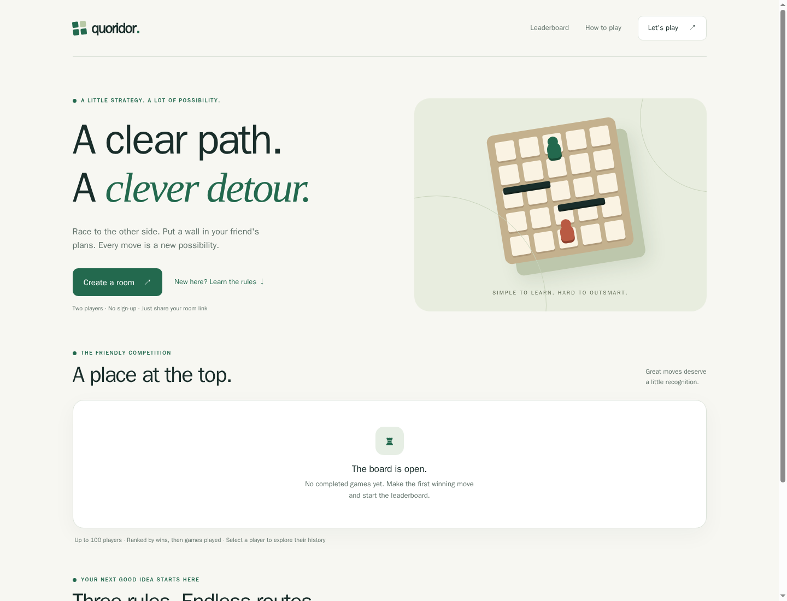

# Quoridor

Play the strategy board game Quoridor with a friend in your browser. Create a room, share its link, then race to the opposite side of the board. On each turn, move your pawn or place a wall to make your opponent take a longer route.



## How to play

- Two players join the same room using its invitation link.
- Move one square toward the opposite edge, or place one of your ten walls.
- Walls can slow your opponent, but each player must always have a path to the finish.
- The first player to reach the far edge wins.

The board supports mouse, touch, and keyboard controls. No account is needed to start a game.

## Run with Docker

```sh
docker run --rm -p 8080:8080 -v quoridor-data:/data farukaf/quoridor:latest
```

Open [http://localhost:8080](http://localhost:8080), create a room, and share its link. The volume keeps the leaderboard, completed-game history, and data-protection keys across container restarts.

## Persistence

SQLite is the default provider. PostgreSQL can be selected through `appsettings.json` or environment configuration. See the [SQLite](docs/configuration/appsettings.SQLite.example.json) and [PostgreSQL](docs/configuration/appsettings.PostgreSql.example.json) examples. Active rooms are in memory, while completed games and player history use the configured database.

## Project

Quoridor is built with Blazor Server on ASP.NET Core.

- [Source code and issues](https://github.com/farukaf/quoridor)
- [Docker Hub image and tags](https://hub.docker.com/r/farukaf/quoridor)
